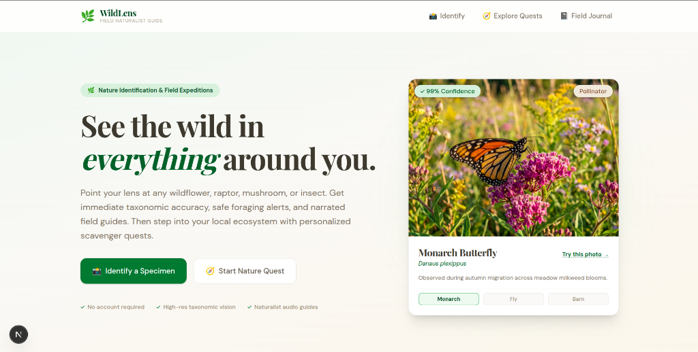
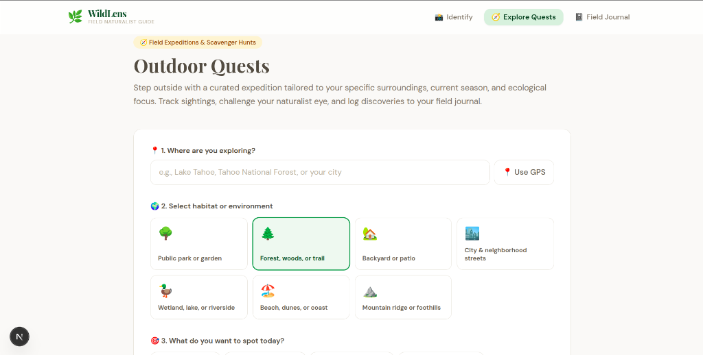
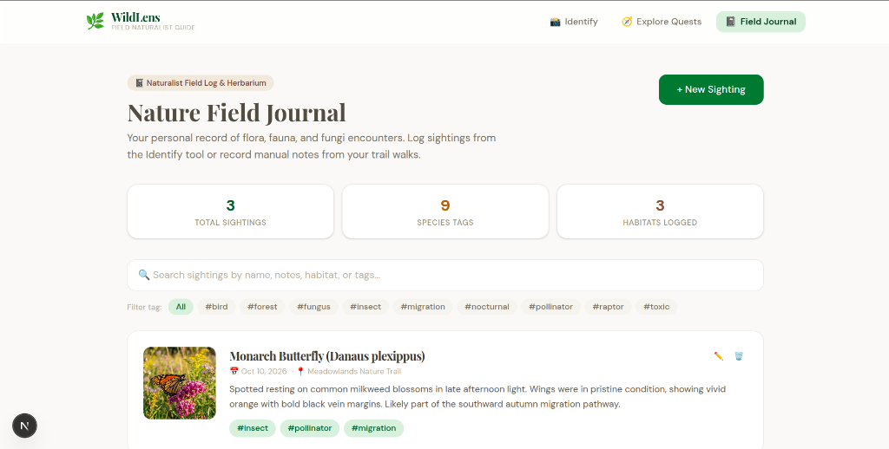

# WildLens 🌿

<p align="center">
  <strong>An intuitive field naturalist guide and biodiversity companion. Discover, identify, and document the living world around you.</strong>
</p>

<p align="center">
  <a href="#overview">Overview</a> •
  <a href="#key-features">Key Features</a> •
  <a href="#screenshots">Screenshots</a> •
  <a href="#architecture--tech-stack">Tech Stack</a> •
  <a href="#getting-started">Getting Started</a> •
  <a href="#deployment-on-render">Deploy on Render</a> •
  <a href="#license">License</a>
</p>

---

## Overview

**WildLens** is an open-source nature companion built to get people off their screens and back into the soil. Whether you're hiking a mountain ridge, strolling through a city park, or exploring your own backyard, WildLens transforms curious outdoor walks into rich ecological learning experiences.

Point your camera or upload a photo of any flower, tree bark, raptor, pollinator, or fungi. WildLens instantly delivers taxonomic classification, field safety warnings (toxic lookalikes, edible traits, handling precautions), distinguishing morphological markers, and narrated audio guides. 

When you're ready to head outside, generate a **Seasonal Outdoor Quest** with habitat-specific scavenger hunts and log every observation directly to your private, offline-first **Nature Field Journal**.

---

## Screenshots

### 1. Landing & Specimen Showcase
<p align="center">
  
</p>

### 2. Seasonal Outdoor Quests
<p align="center">
  
</p>

### 3. Nature Field Journal & Herbarium
<p align="center">
  
</p>

---

## Key Features

### 📸 Visual Specimen Identification
- **Multimodal Botanical & Faunal Recognition**: Instant classification for plants, birds, insects, trees, and fungi.
- **Taxonomic Hierarchy**: Common name, Latin scientific name, family classification, and natural habitat.
- **Field Safety Guidance**: Immediate alerts on toxic lookalikes, irritants, or venomous traits to ensure safe foraging and observation.
- **Distinguishing Markers**: Clear bullet points highlighting leaf margins, plumage patterns, or cap features that separate a species from its lookalikes.
- **Curated Field Samples**: 1-click test photos (*Monarch Butterfly*, *Fly Agaric*, and *Barn Owl*) included out-of-the-box for instant testing.

### 🔊 Narrated Naturalist Audio Guide
- **Hands-Free Field Narration**: High-fidelity, warm naturalist voice narration powered by ElevenLabs (with automatic browser speech synthesis fallback).
- **Trail-Ready**: Listen to species behavior, natural history, and safety details while keeping your eyes on the trail.

### 🧭 Seasonal Outdoor Quests & Scavenger Hunts
- **Habitat-Adjusted Missions**: Generates scavenger hunts specifically calibrated to your environment — public parks, conifer woods, wetlands, beaches, urban streets, or backyards.
- **Seasonal Sensitivity**: Adjusts targets dynamically based on the current calendar month (spring blooms, summer pollinators, autumn foliage & fungi, winter tracks).
- **GPS Reverse Geocoding**: Automatically detects city and regional preserves via OpenStreetMap Nominatim.
- **Observation Checklist**: Interactive checkboxes, difficulty ratings (*Easy*, *Medium*, *Challenging*), and progress tracking.
- **One-Click Field Logging**: Save any spotted quest item directly into your field journal with a single tap.

### 📓 Private Nature Field Journal
- **Offline & Local-First**: Sightings are stored directly in your browser's `localStorage` — no login, no remote tracking, no server dependency.
- **Visual Herbarium**: Record dates, habitat locations, personal field notes, photos, and auto-generated taxonomy tags.
- **Taxonomic Filtering & Search**: Filter entries by `#tag` (e.g. `#bird`, `#fungus`, `#pollinator`, `#toxic`) or search by keyword.
- **Explorer Metrics**: Live counters tracking total sightings, unique species tags, and habitats logged.

---

## Architecture & Tech Stack

| Layer | Technology | Purpose |
|---|---|---|
| **Framework** | [Next.js](https://nextjs.org/) (App Router, Turbopack) | Fast, responsive full-stack React framework |
| **Styling** | Vanilla CSS Tokens & Tailwind CSS | Natural organic aesthetic (earth greens, terracotta, warm stone) |
| **Vision & Taxonomy** | Google GenAI SDK | Morphological classification & structured JSON extraction |
| **Voice Narration** | ElevenLabs API | Warm, natural documentary-style field audio narration |
| **Geocoding** | OpenStreetMap Nominatim API | Reverse geocoding for habitat localization |
| **Storage** | Browser `localStorage` | Private, offline-capable field journal persistence |

---

## Getting Started

### Prerequisites

- [Node.js](https://nodejs.org/) (version 18 or higher)
- `npm`, `yarn`, or `pnpm`

### Installation

1. **Clone the repository**:
   ```bash
   git clone https://github.com/ayushg-1506/WildLens.git
   cd WildLens
   ```

2. **Install dependencies**:
   ```bash
   npm install
   ```

3. **Configure environment variables**:
   ```bash
   cp .env.example .env.local
   ```
   Open `.env.local` and add your keys:
   ```env
   # Required: Google AI Studio key for vision & taxonomy
   GOOGLE_AI_API_KEY=your_google_ai_key_here

   # Optional: ElevenLabs key for audio field guide narration
   ELEVENLABS_API_KEY=your_elevenlabs_key_here
   ```
   > *Get a free Google AI key at [aistudio.google.com](https://aistudio.google.com/apikey).*

4. **Start the local development server**:
   ```bash
   npm run dev
   ```
   Open [http://localhost:3000](http://localhost:3000) in your browser.

---

## Deployment on Render

WildLens is configured for zero-friction deployment on [Render](https://render.com).

### Option 1: Using the Render Blueprint (`render.yaml`)

1. Push your repository to GitHub.
2. Log into the [Render Dashboard](https://dashboard.render.com).
3. Click **New +** → **Blueprint**.
4. Connect your `WildLens` repository.
5. Render will automatically detect `render.yaml` and configure the Web Service.
6. Under Environment Variables, enter your `GOOGLE_AI_API_KEY` (and optionally `ELEVENLABS_API_KEY`).
7. Click **Apply**. Render will install dependencies, build the Next.js app, and deploy it live.

### Option 2: Manual Web Service Setup on Render

1. Log in to [Render](https://dashboard.render.com) and click **New +** → **Web Service**.
2. Connect your GitHub repository: `ayushg-1506/WildLens`.
3. Configure the following build settings:
   - **Environment**: `Node`
   - **Plan**: `Free`
   - **Build Command**: `npm install && npm run build`
   - **Start Command**: `npm start`
4. Add Environment Variables:
   - `GOOGLE_AI_API_KEY` = *your Google AI Studio key*
   - `ELEVENLABS_API_KEY` = *your ElevenLabs key (optional)*
   - `NODE_VERSION` = `20`
5. Click **Create Web Service**. Your app will be live with an automatic HTTPS URL (e.g., `https://wildlens.onrender.com`).

---

## Project Structure

```
WildLens/
├── public/
│   ├── samples/             # Curated field photos (monarch, mushroom, owl)
│   └── screenshots/         # Documentation screenshots
├── src/
│   ├── app/
│   │   ├── api/
│   │   │   ├── identify/    # Multimodal taxonomy & safety API route
│   │   │   ├── quest/       # Seasonal scavenger hunt generator API route
│   │   │   └── tts/         # Naturalist voice synthesis API route
│   │   ├── explore/         # Outdoor Quests page
│   │   ├── identify/        # Specimen recognition & audio guide page
│   │   ├── journal/         # Offline field journal & herbarium page
│   │   ├── globals.css      # Natural color palette tokens & animations
│   │   ├── layout.tsx       # Root layout & typography
│   │   └── page.tsx         # Landing page & specimen showcase
│   ├── components/
│   │   └── Header.tsx       # Navigation header with active states
│   └── lib/
│       └── ai.ts            # Resilient multi-model Gemini client
├── render.yaml              # Render deployment blueprint
├── README.md                # Documentation
└── package.json
```

---

## Design Principles

- **Earth-First Aesthetics**: Intentionally avoids generic neo-brutalist or synthetic neon schemes in favor of natural forest greens, warm ochre, unbleached linen, and botanical typography (*Playfair Display* & *DM Sans*).
- **Action Over Consumption**: Every view is designed to minimize screen time and prompt real-world observation.
- **Privacy by Design**: Field journals and geolocation stay completely on the client device.

---

## License

This project is open-source under the [MIT License](LICENSE).
